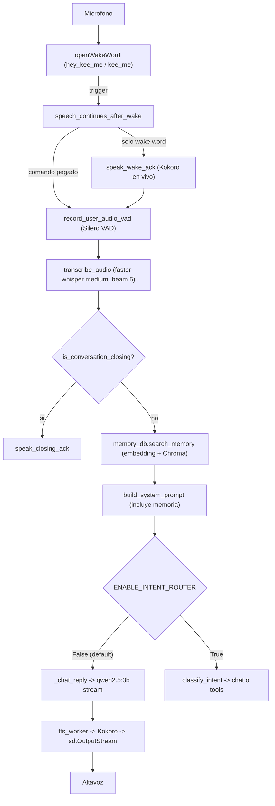

# Kimmi — Roadmap de internacionalización y latencia

> Documento de contexto. Recoge el análisis del motor, las decisiones tomadas y el
> plan por tandas. Sirve como entrada para redactar los planes de las tandas 2, 3 y 4
> sin tener que volver a analizar el código desde cero.
>
> Última actualización: 2026-08-07

---

## 1. Objetivo

Kimmi es un asistente de voz local (estilo Jarvis) que hoy funciona **solo en español**.
Lo que queremos:

1. **Soportar inglés y español**, con **inglés como idioma por defecto**.
2. Que suene **lo más natural posible** en ambos idiomas.
3. Que **responda lo más rápido posible**, y cuando no pueda, que **dé señal de vida
   mientras piensa** para que el usuario sienta que fue escuchado.

Conclusión del análisis: el idioma y la latencia son problemas **independientes**. La
latencia actual no viene del español, viene del pipeline de audio. Por eso el trabajo se
ordena en tandas donde la latencia va primero.

---

## 2. Estado actual del pipeline



Archivos relevantes:

- [`assistant.py`](assistant.py) — bucle principal: audio, VAD, STT, LLM, TTS, barge-in,
  sesión conversacional. Es donde vive casi todo.
- [`tools/registry.py`](tools/registry.py) — schemas de tools para Ollama, handlers y
  `build_system_prompt`.
- [`tools/intent.py`](tools/intent.py) — clasificador de intención, confirmaciones,
  parseo de sí/no.
- [`tools/memory.py`](tools/memory.py) — memoria vectorial (ChromaDB + `nomic-embed-text`).
- Consumidores externos del motor: [`../backend/app/engine_bridge.py`](../backend/app/engine_bridge.py)
  y [`../desktop/bridge.py`](../desktop/bridge.py).

Flags actuales: `ENABLE_INTENT_ROUTER = False`, `ENABLE_TOOLS = False`, `TTS_ENGINE = "kokoro"`.
O sea que el camino caliente hoy es: wake → VAD → Whisper → RAG → qwen2.5:3b streaming → Kokoro.

---

## 3. Dónde vive el idioma hoy

El idioma no está centralizado: está repartido en unos 12 puntos. Se agrupan en tres
categorías porque el criterio de qué hacer con cada una es distinto.

### 3.1 Depende del idioma del usuario (hay que traducir de verdad)

En [`assistant.py`](assistant.py):

- `transcribe_audio` → `language="es"` fijo.
- `STT_INITIAL_PROMPT` — prompt de sesgo con vocabulario de comandos en español.
  Es crítico: sin equivalente inglés, "Kimmi" se transcribirá como "Kimmy/Jimmy/Kimi".
- `play_tts_kokoro` → `lang="es"`, más `KOKORO_VOICE = "ef_dora"` (voz española)
  y `KOKORO_SPEED = 1.2`.
- `WAKE_ACK_PHRASES` y `CLOSING_ACK_PHRASES`.
- `_CLOSING_RE` y `_CLOSING_SOFT_RE` (dos regexes grandes, ~40 alternativas en español)
  y la tupla `starters` dentro de `is_conversation_closing`.
- `_WAKE_PHRASE_RE` — hoy cubre `hey|ey|ok|okay|hola`; falta `hi|yo|hey there` y las
  variantes de transcripción inglesa del nombre.
- Mensajes hablados sueltos e inline, repartidos por `run_conversation_session`,
  `_confirm_action`, `_run_tools_turn` y `handle_user_turn`:
  `"No te escuché bien, ¿puedes repetir?"`, `"Cancelado."`, `"No puedo usar esa herramienta."`,
  `"Listo."`, `"No estoy seguro de lo que pediste..."`, `"Esperando confirmación..."`,
  `"No te escuché. Cuando quieras, vuelve a llamarme."`.

En [`tools/intent.py`](tools/intent.py):

- `_YES_RE` / `_NO_RE`. Ojo: `_YES_RE` ya matchea `ok|okay`, pero le faltan
  `yeah|yep|sure|go ahead|do it|please do`.
- `confirmation_prompt()` — 7 plantillas de frase.
- `_MEMORY_OFFER_RE` — detecta que el asistente ofreció recordar algo.

### 3.2 Mejor dejarlo en inglés siempre (no traducir)

- Las **descripciones de tools** en [`tools/registry.py`](tools/registry.py), que hoy están
  en español. Qwen2.5 hace function calling notablemente más fiable con schemas en inglés,
  y son menos tokens en el prefijo de cada turno.
- `_CLASSIFY_SYSTEM` en [`tools/intent.py`](tools/intent.py) (mismo argumento).
- **El system prompt completo**: escribirlo en inglés y dejar una sola línea variable,
  `"Always reply in {language_name}."`. Así se mantiene **un** prompt en vez de dos y se
  evita que las reglas de cierre y de disciplina de tools se desincronicen entre idiomas.
- Los strings de error internos que llegan al LLM como `role: "tool"`
  ([`tools/cursor_agent.py`](tools/cursor_agent.py), [`tools/memory.py`](tools/memory.py),
  [`tools/fetch_web_docs.py`](tools/fetch_web_docs.py)): el modelo los reformula antes de
  hablar, así que traducirlos no aporta nada.

### 3.3 Rompe cosas si se localiza

Los markers de stdout. Ver la sección 7 (contrato con los frontends).

### 3.4 Nota sobre la memoria vectorial

`nomic-embed-text` es un modelo de embeddings anglocéntrico. Los hechos ya guardados en
`memory/` están en español; si se pregunta en inglés, la recuperación cross-lingual se
degrada bastante. Si queremos bilingüismo real en el RAG hay que cambiar a un embedder
multilingüe (`bge-m3` está disponible en Ollama), lo que implica **reindexar** `memory/`.
Decisión pendiente, ver sección 9.

---

## 4. Hallazgos de latencia

Ordenados por impacto estimado. Todos verificados leyendo el código o las librerías instaladas.

### 4.1 Kokoro corre en CPU

[`requirements.txt`](requirements.txt) lista `onnxruntime==1.28.0` (build CPU), confirmado en
`proj-env/Lib/site-packages/onnxruntime/capi/build_and_package_info.py`
(`package_name = 'onnxruntime'`).

Además, `kokoro_onnx.Kokoro.__init__` fija el provider a CPU y su rama de GPU está muerta:

```python
providers = ["CPUExecutionProvider"]
gpu_enabled = importlib.util.find_spec("onnxruntime-gpu")  # nunca da positivo
if gpu_enabled:
    providers = rt.get_available_providers()
env_provider = os.getenv("ONNX_PROVIDER")  # unica via real
if env_provider:
    providers = [env_provider]
```

`find_spec("onnxruntime-gpu")` no puede dar positivo porque el módulo se llama `onnxruntime`.
Las dos vías reales son la variable `ONNX_PROVIDER` o construir la sesión a mano y pasarla
por `Kokoro.from_session(session, voices_path)`, que sí existe en la librería.

Detalle favorable: [`assistant.py`](assistant.py) importa `torch` (línea 16) mucho antes de
cargar Kokoro (línea ~212), así que las DLLs de CUDA/cuDNN de PyTorch cu121 ya están en el
proceso y `onnxruntime-gpu` puede resolverlas sin instalar el CUDA Toolkit.

### 4.2 La síntesis bloquea la reproducción

`tts_worker` es una cola de **una sola etapa**: saca una frase, la sintetiza, la reproduce, y
solo entonces saca la siguiente. La síntesis de la frase N+1 nunca solapa con el audio de la
frase N. Necesita dos etapas: `text_q → hilo de síntesis → audio_q → reproducción`.

### 4.3 Se abre un stream de audio nuevo por cada frase

`_play_waveform_kokoro` hace `with sd.OutputStream(...)` **y** abre un monitor de micro con
`audio.open(...)` de PyAudio, por frase. En Windows abrir un stream de entrada cuesta del orden
de 50–200 ms. Encima:

- `TTS_DEVICE_WARMUP_MS = 80` de silencio de calentamiento, por frase.
- `KOKORO_LEAD_IN_MS = 280` de silencio inicial, por frase (en `_prepare_kokoro_waveform`).

Son unos 400–600 ms de overhead multiplicados por el número de frases. El lead-in y el warmup
solo tienen sentido en el primer chunk del turno, y desaparecen del todo si el stream de salida
nunca se cierra.

Dato que lo hace fácil: `kokoro_onnx.config.SAMPLE_RATE = 24000` es **constante**, así que un
único stream de salida a 24 kHz sirve para todo el proceso.

### 4.4 Barge-in en lockstep con la salida

El bucle de `_play_waveform_kokoro` alterna `stream.write(chunk)` (bloqueante) con
`monitor.read(VAD_CHUNK)` (bloqueante). Mientras se escribe la salida no se drena el micro, así
que el buffer de entrada se acumula y la detección analiza audio viejo. Además `speech_run_ms` y
`BARGE_IN_GRACE_MS` se reinician en cada frase, así que una interrupción que cae justo en el
límite entre dos frases pierde lo acumulado.

### 4.5 El system prompt cambia cada turno y mata el cache de KV

En `handle_user_turn`:

```python
system_prompt = build_system_prompt(ALLOWED_DATA_ROOT, memory_context=retrieved_context)
```

Los recuerdos del RAG se inyectan **dentro del mensaje de sistema**. Ollama/llama.cpp solo
reutiliza el prefijo cacheado si es byte-idéntico, así que cada turno fuerza un re-prefill
completo del prompt. Solución: system estático, y el bloque de memoria pegado al **final del
mensaje del usuario** (así todo el prefijo `[system] + history` queda idéntico turno a turno).

### 4.6 El RAG corre síncrono en todos los turnos

`memory_db.search_memory(user_text)` hace una llamada de embeddings a Ollama más una query a
Chroma antes de tocar el LLM, incluso para "hola qué tal". No se puede paralelizar con el LLM
(el LLM necesita el resultado), así que la vía es abaratarlo:

- `_get_embedding` llama a `ollama.embeddings(...)` **sin `keep_alive`**, así que
  `nomic-embed-text` usa el default de 5 minutos y se descarga/recarga compitiendo con qwen.
- Gatear el RAG (saltarlo en saludos y utterances muy cortos), cachear `collection.count()`
  y memoizar los últimos pares `query → context`.

Colateral: [`tools/memory.py`](tools/memory.py) instancia `KimmiMemory()` a nivel de módulo y
[`assistant.py`](assistant.py) crea **otra** instancia, o sea dos clientes Chroma sobre el mismo path.

### 4.7 Whisper con beam 5 y VAD duplicado

`WHISPER_MODEL_SIZE = "medium"` con `beam_size=5` y `best_of=5`. Además `transcribe()` recibe
`vad_filter=True`, pero `record_user_audio_vad` **ya** recortó el audio con Silero VAD: es VAD
duplicado sobre el mismo audio.

Opción futura (no en la tanda 1, requiere descarga): `large-v3-turbo` está disponible en
faster-whisper 1.2.1 (`_MODELS["large-v3-turbo"] = "mobiuslabsgmbh/faster-whisper-large-v3-turbo"`,
~1.6 GB). Con `beam_size=1` suele ser más rápido que `medium` con beam 5 y a la vez más preciso,
gracias a su decoder de 4 capas.

### 4.8 No hay prewarm

El primer turno paga la carga en VRAM del modelo de Ollama, la primera inferencia ORT de Kokoro
(la más lenta) y la inicialización de espeak-ng.

### 4.9 Tiempo muerto de 1.25 s tras hablar

`play_tts_sentence` llama a `suppress_wake_word(WAKE_COOLDOWN_SEC)` = 1.25 s **después de cada
frase**, y `_prepare_listen` hace un busy-wait `while wake_word_suppressed()` antes de grabar.
En una sesión conversacional el wake word no se usa para nada, así que son ~1.25 s de silencio
obligatorio entre que Kimmi termina de hablar y puede volver a oírte. Hay que separar el
"cooldown del detector de wake word" del "micro listo para grabar".

### 4.10 El primer chunk de TTS espera a un punto final

El regex de troceo es `([^.!?\n]+[.!?\n]+)`, o sea que espera puntuación terminal. Si el modelo
escribe una primera oración de 25 palabras, no suena nada hasta que la cierra. Solo para el
**primer** chunk conviene cortar también en coma / punto y coma / dos puntos. Ojo con los
decimales (`3.5`, `192.168.1.50`), que el regex actual parte en dos.

---

## 5. Datos verificados de las librerías

Referencia rápida para no volver a comprobarlo:

- **kokoro-onnx 0.5.0**: `SAMPLE_RATE = 24000` constante. `create(text, voice, speed, lang, ...)`
  fonemiza, trocea internamente en batches de hasta `MAX_PHONEME_LENGTH = 510` fonemas
  (cortando por puntuación) y concatena. Existe `create_stream()` (async generator que emite
  por batch de fonemas) y `Kokoro.from_session(session, voices_path)`.
- **Voces Kokoro v1.0** en `voices-v1_0.bin`, sin descargar nada: español `ef_dora` (F),
  `em_alex` / `em_santa` (M). Inglés US: `af_heart` (default y la de mejor calidad),
  `af_bella`, `af_nicole`, `af_sarah`, `am_michael`, `am_puck`. Inglés UK: `bf_emma`, `bm_george`.
- **Códigos de idioma Kokoro**: `en-us`, `en-gb`, `es`, `fr-fr`, `it`, `pt-br`, `hi`, `ja`, `cmn`.
  Nota: el inglés usa un pipeline con diccionario + fallback a espeak, mientras que el español va
  por espeak-ng directo. Son rutas de código distintas; hay que probar el inglés, no darlo por bueno.
- **faster-whisper 1.2.1**: expone `model.detect_language(audio=..., language_detection_segments=N)`,
  que corre solo el encoder + un token de decoder (del orden de 10–50 ms en GPU). Modelos
  disponibles por nombre, entre otros: `medium`, `large-v3`, `large-v3-turbo` / `turbo`,
  `distil-small.en`, `distil-medium.en`.
- **onnxruntime instalado**: build CPU 1.28.0.
- **openWakeWord 0.6.0**: los modelos `hey_kee_me` / `kee_me` son de fonética inglesa, así que
  **funcionan igual en ambos idiomas**. No hay que reentrenar nada para el inglés.

---

## 6. Decisiones tomadas

- **Inglés por defecto**, español disponible. Variable de entorno `KIMMI_LANG`, default `en`.
- **Un objeto `Locale`** centraliza todo lo dependiente del idioma. Regla dura:
  `assistant.py` no debe volver a tener un literal hablado; todo lo que se sintetiza sale del locale.
- **Prompts y schemas de tools en inglés siempre**, con una única línea que fija el idioma de
  respuesta. Un prompt, no dos.
- **Idioma fijo por sesión**, nunca autodetección por turno (añade latencia a todos los turnos y
  con audio corto es inestable). El cambio va por comando explícito, con `detect_language` solo
  como red de seguridad cuando el turno ya iba a fallar.
- **Kokoro a CUDA ya** (`onnxruntime-gpu` + `Kokoro.from_session` con fallback a CPU), en la tanda 1.
- **Whisper: primero solo `beam_size=1`** y quitar el VAD duplicado, sin descargas.
  `large-v3-turbo` queda como opción medida para más adelante.
- **Latencia primero, i18n después.** Los arreglos de latencia son independientes del idioma y se
  pueden validar hoy en español.

---

## 7. Contrato con los frontends (no romper)

[`../backend/app/engine_bridge.py`](../backend/app/engine_bridge.py) y
[`../desktop/bridge.py`](../desktop/bridge.py) clasifican el estado del pipeline haciendo **match
de texto** sobre el stdout del motor. Restricciones:

- Literales que hoy se parsean: `KIMMI EN ESPERA`, `Volviendo a estado de espera`,
  `[Wake Word Detectado`, `[VAD]:`, `[Tú]:`, `[Intent]:`, `[LLM]:`, `[Tools]:`, `[Cierre]:`,
  `[Sesión]:`, `[Memoria]:`, `[RAG Memoria]:`, `[Kimmi]:`, `[Confirmación]:`,
  `Escuchando (sesión activa)`, `Usando audio del barge-in`, `Kimmi ejecutando`.
- `desktop/bridge.py` define `_SPEECH_MARKERS = ("[Kimmi]:", "[Confirmación]:")` y va ingiriendo
  **carácter a carácter** todo lo que se imprime después del marker para animar la onda. Por eso
  `stream_ollama_to_tts` debe seguir imprimiendo los deltas de tokens de forma incremental con
  `flush=True`, aunque cambie por dentro.
- Las líneas de métricas nuevas usan prefijo `[perf]`, que no matchea ningún marker de ninguno de
  los dos bridges: son inertes.
- **Cuando llegue la tanda 3** hay que sustituir estos markers en español por markers neutros
  (idealmente una línea JSON tipo `{"state":"listening"}`) y adaptar los dos bridges en el mismo commit.

---

## 8. Plan por tandas

### Tanda 1 — Latencia del pipeline de voz (implementada)

> **Estado: hecha.** Las secciones 2 a 6 de este documento describen el pipeline **anterior**
> a esta tanda y se conservan porque explican el *porqué* de cada cambio. El pipeline vigente
> es el de `engine/audio_out.py` + `engine/perf.py`. Resultados y hallazgos al final de esta
> sección.

Objetivo medible: **TTFA** (time-to-first-audio), desde que el VAD corta la frase del usuario
hasta la primera muestra audible. Estimado antes en 2–3 s para un turno de chat simple; objetivo
por debajo de 900 ms.

Alcance (detalle completo en el plan de Cursor `kimmi_latencia_tanda_1`):

1. **Instrumentación** — nuevo `engine/perf.py`, una línea `[perf]` por turno con
   `stt / rag / llm_ttft / synth1 / ttfa / total`. Medir la línea base antes de tocar nada.
2. **Kokoro en GPU** — `onnxruntime-gpu==1.28.0` + `rt.InferenceSession(providers=[CUDA, CPU])`
   pasada por `Kokoro.from_session`, con fallback a CPU y log del provider efectivo.
3. **Capa de audio nueva** (`engine/audio_out.py`) — un único `sd.OutputStream` con callback a
   24 kHz abierto una vez; `SpeechPipeline` de dos etapas; `BargeInMonitor` en su propio hilo;
   `split_for_tts` con corte agresivo solo en el primer chunk. Elimina `KOKORO_LEAD_IN_MS` y
   `TTS_DEVICE_WARMUP_MS`.
4. **System prompt estático** + memoria al final del mensaje del usuario; `keep_alive` en el
   embedding; gateo y cacheo del RAG; instancia única de `KimmiMemory`.
5. **Prewarm** de Ollama, embeddings, Kokoro y Whisper; `options` explícitas (`num_ctx`, `num_predict`).
6. **STT**: `beam_size=1`, `best_of=1`, fuera el `vad_filter` duplicado.
7. **Separar** el cooldown de wake word del `MIC_SETTLE_SEC` de `_prepare_listen`.

#### Resultados medidos

Tres turnos reales de chat contra `qwen2.5:3b`, sin micrófono (texto inyectado), midiendo desde
el inicio del turno hasta la primera muestra audible:

| Turno | `llm_ttft` | `synth1` | **`ttfa`** | audio hablado |
| --- | --- | --- | --- | --- |
| "Hola Kimmi, qué tal estás?" | 297 ms | 219 ms | **593 ms** | 1.0 s |
| "Cuánto es diecisiete por veintitrés?" | 186 ms | 202 ms | **468 ms** | 1.4 s |
| "Explícame qué es una GPU" | 202 ms | 343 ms | **750 ms** | 9.3 s |

En el turno largo se hablaron 9.3 s de audio en 9.31 s de reloj: la síntesis nunca se quedó
atrás y no hubo huecos entre chunks, que era el objetivo del pipeline de dos etapas.

Coste que se eliminó, medido en esta máquina, **por frase** en el camino anterior:
abrir `sd.OutputStream` 63 ms + abrir el mic de barge-in 15 ms + `TTS_DEVICE_WARMUP_MS` 80 ms +
`KOKORO_LEAD_IN_MS` 280 ms = **438 ms fijos**, más la síntesis en CPU.

Kokoro, misma frase, misma máquina (RTX 3060 Ti):

| | chunk corto | chunk largo |
| --- | --- | --- |
| CPU | 516 ms (RTF 0.31) | 906 ms (RTF 0.29) |
| CUDA | 110 ms (RTF 0.067) | 203 ms (RTF 0.064) |

#### Hallazgos que cambian decisiones futuras

- **`onnxruntime-gpu` se queda en 1.22.0, no 1.28.0.** El wheel 1.28 está compilado contra
  **CUDA 13.0** y falla con `CUDA failure 801` en el driver 560.94 (que soporta hasta CUDA 12.6),
  cayendo silenciosamente a CPU. El 1.22.0 apunta a CUDA 12.2 y funciona. No subir la versión sin
  comprobar `onnxruntime.capi.build_and_package_info.cuda_version` contra el driver instalado.
- **El riesgo de `beam_size=1` con `MIN_AVG_LOGPROB` queda descartado.** Medido sobre 5 frases:
  el `avg_logprob` se mueve entre -0.05 y -0.44, muy lejos del umbral de -1.0. No hace falta
  aflojarlo a -1.2.
- **Pero beam 1 solo ahorra ~40 ms** (390 → 360 ms sobre `medium`) y en 2 de 5 frases degradó
  nombres propios, incluida la propia wake word. Si aparecen fallos de `strip_wake_phrase`,
  volver a beam 5 cuesta poco. El STT ya no es el cuello de botella.
- **El RAG hoy es gratis** (`rag=0 ms`) porque la base de recuerdos está vacía y el `count()`
  cacheado corta antes de pagar el embedding. Habrá que volver a medirlo con memoria poblada.

### Tanda 2 — Respuesta inmediata (implementada)

> **Estado: hecha.** El texto que sigue es el diseño original; las decisiones que cambiaron al
> medir, y los resultados, están al final de la sección.

Un filler incondicional **empeora** los turnos rápidos, porque mete habla delante de una respuesta
que ya estaba lista. El diseño es en tres capas, cada una activándose solo si la anterior no llegó
a tiempo:

- **Capa 0 — earcon (~0 ms, sin idioma).** Un tono corto y suave en cuanto el VAD corta la frase
  del usuario. Array de numpy pregenerado, no pasa por TTS, no tiene idioma ni coste.
- **Capa 1 — filler pregrabado y condicional (~150 ms).** Se lanza el stream del LLM en un hilo y
  se arma un timer de ~350–450 ms. Si el primer token llega antes, no pasa nada; si no, se
  reproduce un filler desde caché ("Mm-hm.", "One sec.", "Let me check."). Clave: estos clips se
  sintetizan **una vez** al arrancar o se cachean en `.kimmi_cache/tts/`. Sintetizarlos en caliente
  costaría más que la latencia que intentan tapar.
- **Capa 2 — streaming**, que ya existe, más el troceo agresivo del primer chunk de la tanda 1.

El mismo caché de audio resuelve otra cosa: `WAKE_ACK_PHRASES` y `CLOSING_ACK_PHRASES` son
conjuntos **fijos y cerrados**, y hoy `speak_wake_ack()` llama a Kokoro en vivo para decir
"Sí, Fede?". Pregenerando las ~7 frases de cada set por locale (unos 30 clips en total), el acuse
del wake word pasa a ser instantáneo. Las plantillas de `confirmation_prompt` con argumentos
variables no se pueden cachear enteras, pero sí su prefijo fijo.

Caso especial: `_run_tools_turn` llama al modelo pesado **sin stream** (`ollama.chat` bloqueante)
y solo habla al terminar. Es el peor caso de latencia con diferencia, y ahí el filler debe ser
explícito ("Checking that now.") y dispararse sin esperar el timer, porque ya sabemos que va a tardar.

Depende de: la infraestructura de audio de la tanda 1 (el `AudioSink` es quien reproduce los clips).

#### Lo que cambió al implementarla

- **El umbral del filler pasó de 350–450 ms tras el LLM a 1200 ms desde el corte del VAD.** Las
  medidas de la tanda 1 invalidaron la propuesta original: el primer token llega en 186–297 ms,
  así que ese timer no se dispararía nunca. Contando desde el inicio del turno, y con los 830–1100 ms
  de punta a punta actuales, el relleno solo aparece cuando algo va lento de verdad.
- **El earcon quedó implementado pero apagado** (`EARCON_ENABLED = False`).
- **Los prefijos de `confirmation_prompt` no se cachean.** Partirlos en prefijo fijo más sufijo en
  vivo mete una costura de prosodia a cambio de casi nada, y hoy `ENABLE_TOOLS = False`.
- **El filler no imprime nada.** `desktop/bridge.py` ingiere stdout crudo tras `[Kimmi]:` y corta en
  el primer `\n`; `stream_ollama_to_tts` deja esa línea abierta antes del primer token, así que
  cualquier print desde el hilo del timer congelaría la onda del HUD el resto de la respuesta.
  El relleno se registra solo en la línea `[perf]`, que sale al cerrar el turno.
- **`AudioSink.enqueue` acepta `notify=False`.** Earcon y filler no deben contar como `ttfa`: esa
  métrica tiene que seguir midiendo la primera muestra de la respuesta real y ser comparable con
  la tanda 1.

#### Resultados medidos

Acuse del wake word ("Sí, Fede?"), mismo texto, dos ejecuciones:

| | en vivo | cacheado |
| --- | --- | --- |
| primer audio | 218 / 171 ms | **0 / 15 ms** |

El caché son 26 clips (`WAKE_ACK_PHRASES` + `CLOSING_ACK_PHRASES` + `FILLER_PHRASES` + `SPOKEN`).
Primera ejecución: 5.4 s de síntesis dentro del `warmup()`. Segunda: 0 sintetizados, 0.0 s, y el
`warmup()` completo baja de 6.9 s a 1.3 s.

`ttfa` del camino de chat normal contra la tanda 1 — sin regresión:

| Turno | tanda 1 | tanda 2 |
| --- | --- | --- |
| "Hola Kimmi, qué tal estás?" | 593 ms | 577 / 547 ms |
| "Cuánto es diecisiete por veintitrés?" | 468 ms | 577 / 500 ms |
| "Explícame qué es una GPU" | 750 ms | 844 / 1140 ms |

El turno largo se mueve porque `synth1` sigue al largo de la primera frase que produce el LLM
(343 / 375 / 500 ms), no por la capa de audio: en el acuse cacheado el sink añade 0–16 ms sobre
`synth1`, que es todo lo que cuesta la tupla `(samples, notify)` de la deque.

Con `FILLER_AFTER_MS = 0` forzado, el relleno suena antes que la voz (`filler=0`, `ttfa=781`) y la
línea `[Kimmi]:` sale entera y sin cortes, que era la regresión temida. Con audio ya encolado, la
guarda `has_emitted_audio / pending_seconds` lo suprime.

Earcon (90 ms, pico 0.12, bordes exactamente a 0): score de wake word **0.0009** contra un umbral
de 0.5, y 0 de 2 chunks marcados como voz por el VAD de barge-in, que además pide 400 ms seguidos.
No dispara ninguno de los dos.

### Tanda 3 — Internacionalización

Nuevo `engine/locale_config.py` con un dataclass congelado y un holder mutable
(`current_locale()` / `set_locale(code)`), porque el cambio debe poder ocurrir a mitad de sesión:

```python
@dataclass(frozen=True)
class Locale:
    code: str                    # "en" | "es"
    language_name: str           # "English" -> se inyecta en el system prompt
    whisper_language: str
    stt_initial_prompt: str
    tts_lang: str                # "en-us" | "es"
    tts_voice: str               # "af_heart" | "ef_dora"
    tts_speed: float
    wake_ack_phrases: tuple[str, ...]
    closing_ack_phrases: tuple[str, ...]
    filler_phrases: tuple[str, ...]
    closing_re: re.Pattern
    closing_soft_re: re.Pattern
    wake_phrase_re: re.Pattern
    yes_re: re.Pattern
    no_re: re.Pattern
    ui: dict[str, str]           # mensajes cortos hablados
    confirm: dict[str, str]      # plantillas de confirmacion
```

Tareas:

- Extraer todo lo del inventario 3.1 al locale. `tools/intent.py` y `tools/registry.py` reciben el
  locale como parámetro o leen el holder (cuidado con imports circulares).
- Pasar prompts y descripciones de tools a inglés (inventario 3.2), con la línea única
  `"Always reply in {language_name}."`.
- Sustituir los markers de stdout en español por markers neutros y adaptar
  `backend/app/engine_bridge.py` y `desktop/bridge.py` **en el mismo commit**.
- Ajustes de naturalidad en inglés: voz `af_heart`, `tts_speed` 1.0–1.05 (el 1.2 actual suena
  acelerado en inglés), y añadir al system prompt "usa contracciones, nada de 'Certainly!' ni
  'As an AI', y **escribe los números en palabras**" (los números literales son la fuente número
  uno de TTS que suena a robot).
- Regenerar el caché de audio de la tanda 2 para el nuevo locale.

### Tanda 4 — Cambio de idioma

Tres capas, de más rápida a más lenta:

1. **Comando explícito (~0 ms)**: regex sobre el transcript antes de llamar al LLM —
   `"speak spanish"`, `"in english"`, `"habla en inglés"`, `"cambia a español"`. Cambia el locale y
   responde con una frase pregrabada del **nuevo** idioma. Cubre el 95% de los casos reales.
2. **Fallback por calidad**: si Whisper con el idioma activo devuelve `avg_logprob` malo o el filtro
   de calidad tumba todos los segmentos, en vez de decir "no te escuché" se corre
   `whisper_model.detect_language(audio)` y, si detecta el otro idioma con probabilidad alta, se
   re-transcribe. Solo se paga en el turno que ya iba a fallar.
3. **Nunca** `language=None` en el camino feliz.

Corolario: esto obliga a mantener un STT **multilingüe**, así que quedan descartados `small.en` y
los `distil-*.en` aunque sean más rápidos.

---

## 9. Preguntas abiertas

- **Embeddings multilingües.** ¿Migramos `nomic-embed-text` a `bge-m3` para que el RAG funcione
  cross-lingual? Implica reindexar `memory/`. Decidir en la tanda 3.
- **LLM para inglés.** `qwen2.5:3b` funciona, pero `llama3.2:3b` tiende a sonar más natural y
  coloquial en inglés conversacional. Es una línea de config: merece un A/B en la tanda 3.
- **`large-v3-turbo`.** Pendiente de medir contra `medium` con beam 1, una vez tengamos la
  instrumentación de la tanda 1.
- **Code-switching** dentro de una misma frase (mezclar inglés y español). Whisper multilingüe lo
  tolera, pero el TTS no: `lang` es un parámetro por llamada. Por ahora se asume una frase, un idioma.
- **Voz en inglés.** `af_heart` es la recomendación por calidad, pero conviene escuchar
  `af_bella` y `af_nicole` para elegir la que más se parezca al timbre de `ef_dora`, de forma que
  Kimmi se sienta "la misma persona" en los dos idiomas.

---

## 10. Cómo medir

Métrica principal: **TTFA**, desde el retorno de `record_user_audio_vad` (fin de habla) hasta el
primer bloque no silencioso entregado por el callback de audio.

Batería fija de 5 casos, para poder comparar entre tandas:

1. Chat corto ("qué hora es" / "how are you").
2. Chat corto con hit de memoria (dispara el RAG).
3. Respuesta larga de varias frases (mide los huecos entre frases y el adelanto de la síntesis).
4. Barge-in a mitad de respuesta.
5. Turno de seguimiento dentro de una sesión activa (mide el tiempo muerto post-TTS).

Se reporta la línea `[perf]` de cada caso, antes y después. Cualquier tanda que no mueva estos
números no cumplió su objetivo.
