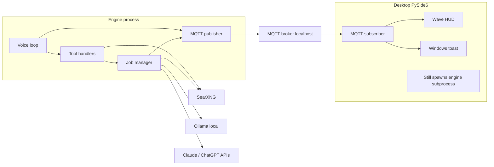
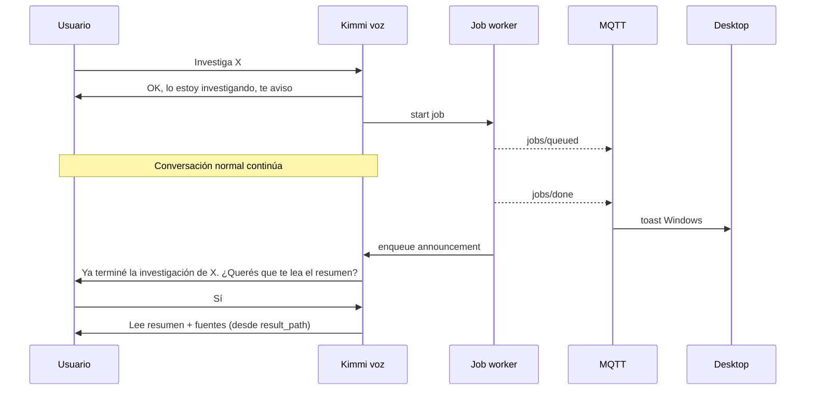

# Kimmi — Roadmap 2: Internet tools, jobs en background y bus de eventos

> Documento de contexto para planificar e implementar por fases.
> No es un plan de ejecución: es la fuente de verdad para redactar planes
> (CreatePlan) **una fase a la vez**.
>
> Relacionado: [`ROADMAP.md`](ROADMAP.md) (i18n + latencia de voz). Este archivo
> cubre capacidades nuevas de producto: red, búsqueda, jobs largos, MQTT, toasts.
>
> Última actualización: 2026-08-10

---

## 0. Opinión sobre el approach (decisión tomada)

### Propuesta del usuario (aprobada)

1. **MQTT** como bus de eventos, sustituyendo la lógica de markers stdout → desktop.
2. Toasts de Windows en la app desktop, alimentados por MQTT.
3. Adaptar desktop a MQTT.
4. Después: conectividad + `web_search` (SearXNG) + prompt anti-alucinación +
   framework de jobs + aviso al terminar + “¿te leo el resultado?”.
5. Tool **Research agent**.
6. Tool **Scraping / análisis de competencia**.

### Por qué MQTT tiene sentido aquí

Hoy el contrato engine↔desktop es **texto en stdout** parseado en
[`../desktop/bridge.py`](../desktop/bridge.py) (`parse_engine_line`, markers
tipo `KIMMI READY`, `[Wake Detected`, `[Kimmi]:`, etc.). Funciona para el HUD
de la onda, pero:

- Es frágil (un print de debug puede confundir estados).
- No escala a varios consumidores (otra UI, IoT, scripts, móvil).
- No modela bien eventos tipados (`job.done`, `job.failed`, `notify`).
- Mezcla logs humanos con protocolo de control.

MQTT aporta:

- Topics tipados y varios suscriptores sin acoplar al proceso del engine.
- Retained messages / QoS si hace falta (p.ej. último estado del pipeline).
- Encaje natural con domótica / sensores / “implementaciones futuras”.
- El toast de Windows y la voz pueden reaccionar al **mismo** evento
  `kimmi/jobs/{id}/done` sin duplicar lógica.

### Matices importantes (no negociables en el diseño)

1. **No borrar stdout del todo en la fase 1.** El subprocess seguirá imprimiendo
   logs para depuración humana. Lo que se **sustituye** es el *contrato de
   control* (estados del HUD + eventos de jobs). Durante una ventana corta de
   migración, el bridge puede aceptar ambos; el objetivo final es MQTT-only
   para control.
2. **Broker local.** El desktop **spawnea** Mosquitto al abrir y lo **detiene** al cerrar si es su hijo (`MosquittoSupervisor`). Si `1883` ya está ocupado, reutiliza el broker existente y no lo mata. Variables: `KIMMI_MQTT_HOST`, `KIMMI_MQTT_PORT`, `KIMMI_MQTT_PREFIX` (default `kimmi`), `KIMMI_MOSQUITTO_BIN`.
3. **El engine sigue siendo subprocess del desktop.** MQTT no reemplaza el
   spawn del proceso; reemplaza el parseo de stdout como bus de UI/eventos.
4. **Si el broker no está, degradar con claridad:** HUD en `error` /
   mensaje “MQTT unavailable”, no silenciar fallos.
5. **Lifecycle / shutdown limpio (obligatorio en todas las fases).** Ver §0.1.

### Asunciones confirmadas por el usuario

| Tema | Decisión |
|------|----------|
| SearXNG | URL local, default `http://127.0.0.1:8080`, override `KIMMI_SEARXNG_URL`. Documentar; no empaquetar Docker de SearXNG en la primera entrega salvo plan aparte. |
| Claude / ChatGPT | Solo si existen `ANTHROPIC_API_KEY` / `OPENAI_API_KEY`. Si faltan, Kimmi lo dice por voz. |
| Aviso al terminar job | Toast Windows **y** frase hablada (“ya está listo; ¿querés que te lo lea?”), sin cortar una respuesta TTS en curso (esperar hueco / fin de frase). |
| Scraping competencia | Búsqueda + pocas URLs públicas + resumen LLM. **No** crawler agresivo ni evasión de anti-bot. |
| Modelos de pago | Opcionales; el default es local (Ollama + SearXNG). Kimmi **pregunta** explícitamente: ¿lo busco yo (local) o uso Claude/ChatGPT? |
| Sin internet | Error controlado `{"error": "no_internet"}`; el system prompt prohíbe inventar resultados. |
| Shutdown | Al cerrar la app desktop o detener el engine: **todos** los procesos hijos, threads de red, clientes MQTT y puertos/sockets abiertos por Kimmi se detienen o cierran. Nada queda huérfano. |
| Mosquitto | El **desktop spawnea** Mosquitto al abrir y lo **detiene** al cerrar si es hijo suyo. Si el puerto ya estaba ocupado por un broker de sistema, lo reutiliza y **no** lo mata al salir. Mosquitto debe estar instalado (PATH o `KIMMI_MOSQUITTO_BIN`); Kimmi no lo descarga. |

### 0.1 Lifecycle: cierre limpio (regla transversal)

Cualquier plan/implementación de las fases A–D debe incluir shutdown explícito.
No es “nice-to-have”: es criterio de aceptación.

**Cuándo se dispara**

1. Usuario cierra la ventana desktop (`closeEvent`) / sale de la app.
2. `EngineBridge.stop()` / terminate del subprocess del engine.
3. `KeyboardInterrupt` / salida normal de `assistant.py` (`finally`).
4. Crash controlado: best-effort cleanup en `atexit` / `try/finally`.

**Qué hay que cerrar (checklist de diseño)**

| Recurso | Quién lo posee | Al cerrar |
|---------|----------------|-----------|
| Subprocess `assistant.py` | Desktop bridge | `terminate` → wait corto → `kill` si hace falta (ya existe patrón; no regresar) |
| Cliente MQTT engine | Engine `mqtt_bus` | `loop_stop` + `disconnect` + join del thread de red |
| Cliente MQTT desktop | Desktop listener | Igual: disconnect + stop thread antes de destruir Qt |
| Mic / PyAudio / OutputStream TTS | Engine | `stop_stream` / `close` / `terminate` (ya en `finally`; no romperlo) |
| Job workers (ThreadPool / threads) | `JobManager` | `shutdown(wait=False)` o cancel + flag `stopping`; no aceptar jobs nuevos; no dejar threads non-daemon colgados |
| HTTP en vuelo (SearXNG, fetch URLs, APIs cloud) | Workers / tools | Timeouts ya existentes; al shutdown, no reintentar; threads daemon o interrumpibles |
| Sockets locales abiertos por Kimmi | Quien escuche | Close explícito |
| Broker Mosquitto | Desktop `MosquittoSupervisor` | Si `owned=True` (Kimmi lo spawneó): terminate/kill en `closeEvent`. Si el puerto ya tenía un broker externo (`owned=False`): **no** matarlo. |
| SearXNG / Ollama | **Externos** (no spawneados por Kimmi en el diseño base) | Kimmi **no** los mata al salir. Si en el futuro Kimmi **arranca** alguno como hijo, entonces **sí** debe pararlo en el mismo teardown. |

**Regla de oro:** si Kimmi (desktop o engine) **abre** un puerto, **crea** un proceso hijo o **arranca** un thread de larga duración, el path de cierre debe **revertirlo**. Servicios que el usuario levantó a mano (SearXNG, Ollama, o un Mosquitto de sistema ya escuchando) no se matan; el Mosquitto **hijo** del desktop sí.

**Contrato desktop → engine**

```text
closeEvent / quit
  → mqtt_desktop.disconnect()
  → bridge.stop()          # SIG/terminate engine
  → engine finally:
        job_manager.shutdown()
        mqtt_bus.disconnect()
        audio/mic cleanup
  → mosquitto_supervisor.stop()  # solo si owned
  → tray/icon hide
```

**Criterio de prueba manual (todas las fases)**

- [ ] Tras cerrar la app: no queda `python … assistant.py` en el Administrador de tareas.
- [ ] No quedan conexiones MQTT de Kimmi al broker; si Kimmi spawneó Mosquitto, ese proceso tampoco queda.
- [ ] Con un job en curso: al cerrar, el worker no sigue escribiendo a disco de forma indefinida (se corta o termina el chunk actual y sale).
- [ ] Reabrir la app arranca limpio (sin “address already in use” por un Mosquitto hijo huérfano).
---

## 1. Objetivo de producto

Kimmi debe poder:

1. Saber si hay **internet** antes de tools de red.
2. **Buscar en la web** (SearXNG) y responder con hechos, sin alucinar si falla la red.
3. Lanzar tareas **largas** (research, competencia) en **background** mientras
   sigue conversando.
4. Al terminar: **toast de Windows** + aviso por voz + pregunta
   “¿te leo el resultado?”.
5. Ofrecer backend de investigación **local** vs **Claude/ChatGPT** (si están
   configurados).
6. Comunicar estado UI/jobs por **MQTT**, no por markers stdout.

---

## 2. Estado actual del sistema (baseline 2026-08-10)

### 2.1 Pipeline de voz

Ver [`ROADMAP.md`](ROADMAP.md) §2. Resumen: wake word (openWakeWord) → VAD →
Whisper → (opcional intent/tools) → Ollama → Kokoro TTS. Flags típicos:

- `ENABLE_TOOLS` — a menudo `False` en el camino caliente; **hay que activarlo**
  para estas features (o un flag más fino `ENABLE_WEB_TOOLS`).
- `ENABLE_INTENT_ROUTER` — opcional; si está off, el modelo ve todos los schemas.

### 2.2 Tools hoy

Registro central: [`tools/registry.py`](tools/registry.py)
(`build_tools`, `build_system_prompt`).

| Tool | Red | Sync | Notas |
|------|-----|------|--------|
| `fetch_web_docs` | Sí (allowlist hosts) | Sync, timeout 15s | Docs oficiales, no búsqueda general |
| `run_cursor_agent` | Sí (API Cursor) | Sync, bloquea turno | Ya es “largo” pero **bloquea** la conversación |
| Resto (files, docker, clipboard, …) | No / local | Sync | — |

**No existe:** `web_search`, probe de conectividad, job queue, research agent,
competitive scrape, MQTT client, toasts.

### 2.3 Confirmaciones

En [`tools/intent.py`](tools/intent.py) + `_confirm_action` en `assistant.py`:
sí/no por voz **antes** de ejecutar side-effects. Las tools de research deberán
usar un patrón distinto:

- Confirmación **previa** de “¿local o cloud?” (y posiblemente “¿arranco el job?”).
- Confirmación **posterior** de “¿te leo el resultado?” (cuando el job ya terminó).

### 2.4 Desktop

- [`../desktop/app.py`](../desktop/app.py) — ventana 200×200 always-on-top, PySide6.
- [`../desktop/bridge.py`](../desktop/bridge.py) — `Popen` del engine + parseo stdout.
- **Sin** `QSystemTrayIcon`, **sin** toasts, **sin** MQTT.
- Backend FastAPI/WS (`../backend/`) está **deprecated**; no basar el diseño nuevo ahí.

### 2.5 Concurrencia actual

Solo threads locales (TTS, barge-in, clip priming). **No** hay cola de jobs,
job IDs, ni “seguir hablando mientras corre una tool”.

### 2.6 Prompt de disciplina de tools (punto de extensión)

`build_system_prompt` hoy dice: no inventar resultados de tools; una tool por
turno; etc. Hay que **añadir** reglas explícitas para:

- `error: no_internet` / `searxng_unavailable` / `provider_not_configured`
- Jobs en background (no fingir que ya tenés el resumen)
- Oferta local vs cloud

---

## 3. Arquitectura objetivo



### 3.1 Topics MQTT propuestos (contrato)

Prefijo: `kimmi` (configurable).

| Topic | Dirección | Payload (JSON) | Uso |
|-------|-----------|----------------|-----|
| `kimmi/pipeline/state` | engine → | `{state, message, ts}` | HUD: idle/listening/processing/responding/error/starting |
| `kimmi/pipeline/amplitude` | engine → | `{amplitude, ts}` | Onda (si se publica; puede quedar local al desktop si no hace falta) |
| `kimmi/tts/active` | engine → | `{active: bool}` | Desktop/otros saben si está hablando |
| `kimmi/jobs/queued` | engine → | `{job_id, kind, title, ts}` | Opcional UI |
| `kimmi/jobs/progress` | engine → | `{job_id, pct?, stage, ts}` | Feedback opcional |
| `kimmi/jobs/done` | engine → | `{job_id, kind, title, ok, summary_path?, error?, ts}` | Toast + cola de aviso por voz |
| `kimmi/jobs/failed` | engine → | igual que done con `ok:false` | Toast de error |
| `kimmi/notify` | engine → | `{title, body, level, job_id?}` | Toast genérico |
| `kimmi/desktop/ack` | desktop → | `{event_id, action}` | Futuro (click en toast); no bloquea fase 1–2 |

Estados `pipeline/state` deben mapear 1:1 a los actuales del HUD:
`starting | idle | listening | processing | responding | error`.

### 3.2 Modelo de jobs

```text
Job = {
  id: uuid,
  kind: "research" | "competition" | "web_search_batch" | ...,
  title: str,           # corto para toast/voz
  status: queued|running|done|failed|cancelled,
  provider: "local" | "claude" | "chatgpt",
  created_at, started_at, finished_at,
  result_path: path under .kimmi_cache/jobs/{id}/,
  error: optional structured code,
  speak_on_done: true
}
```

- Persistencia mínima: JSON en `{ALLOWED_DATA_ROOT}/.kimmi_cache/jobs/`.
- Ejecución: `threading.Thread` o `concurrent.futures.ThreadPoolExecutor`
  (1–2 workers al inicio; suficiente en PC local).
- El voice loop **nunca** espera al worker: la tool de “start” retorna al LLM
  en &lt;1s con `{job_id, status: "queued", message: "..."}`.
- Al completar: publicar MQTT `jobs/done` + encolar aviso hablado en el engine
  (`pending_job_announcements` que el session loop drena cuando no hay TTS activo
  y, si hace falta, tras wake / hueco de sesión).

### 3.3 Flujo de aviso al usuario (voz + toast)



Reglas:

- No interrumpir TTS a mitad de frase por un job done (salvo barge-in del usuario).
- Si el usuario está en sesión conversacional: anunciar en el próximo hueco.
- Si está en idle (solo wake word): o bien toast-only hasta que diga la wake word,
  o un anuncio corto sin exigir wake (decisión de producto en el plan de fase 2;
  **preferencia documentada:** anuncio hablado breve también en idle si el mic
  no está en cooldown de eco, para que se sienta “vivo”; si hay duda de eco,
  toast-first + anuncio en el próximo wake).
- “¿Te lo leo?” → si sí, leer resumen (TTS); si no, “Cuando quieras, pedímelo.”

---

## 4. Fases (orden de implementación)

Cada fase debe terminar en un estado demoeable. Los planes CreatePlan se
redactan **por fase**, usando este documento como input.

| Fase | Nombre | Dependencias | Entregable demo |
|------|--------|--------------|-----------------|
| **A** | MQTT + desktop toasts + migración HUD | Ninguna de B–D | HUD vía MQTT; toast de prueba al publicar `kimmi/notify` |
| **B** | Conectividad + `web_search` + jobs framework + aviso | A (MQTT/toast) | “Buscá X” sync; job dummy largo → toast + “¿te leo?” |
| **C** | Research agent | A + B | “Investigá Y” → job real → resumen con fuentes |
| **D** | Competitive analysis | A + B (+ C helpers) | “Analizá competencia de Z” → job largo → resumen |

---

## 5. Fase A — MQTT, migración del desktop, toasts Windows

### 5.1 Objetivos

1. Introducir cliente MQTT en el **engine** (publisher de pipeline + notify).
2. Introducir cliente MQTT en **desktop** (subscriber).
3. Sustituir `parse_engine_line` como fuente de verdad del HUD.
4. Implementar **Windows toast** (tray o WinRT).
5. Mantener spawn del engine como hoy.
6. Documentar broker + env vars.

### 5.2 Trabajo técnico detallado

#### Engine

- Nuevo módulo p.ej. [`tools/../mqtt_bus.py`](mqtt_bus.py) o `engine/mqtt_bus.py`:
  - connect/reconnect con backoff
  - `publish_state(state, message)`
  - `publish_notify(title, body, level=info, job_id=None)`
  - `publish_job_*` (stubs usados en fase B)
- Instrumentar puntos del voice loop que hoy equivalen a markers:
  - ready / idle
  - wake / listening
  - processing (STT/LLM/tools)
  - responding (TTS)
  - error
- Librería sugerida: `paho-mqtt` (añadir a `engine/requirements.txt`).
- No meter lógica de negocio en el bus: solo transporte.

#### Desktop

- Dependencia MQTT (`paho-mqtt`) en `desktop/requirements.txt`.
- Nuevo `desktop/mqtt_bridge.py` (o ampliar `bridge.py`):
  - Thread de red MQTT → Qt signals (`state_updated`, `notify_requested`, …)
  - API `start()` / `stop()` simétrica: `stop()` desconecta MQTT y join del thread.
- Toasts:
  - Opción preferida en Windows: `QSystemTrayIcon.showMessage(title, body)`
    (requiere icono en bandeja; añade presencia en tray aunque la ventana se
    minimice — **recomendado** añadir tray mínimo).
  - Alternativa: `win11toast` / WinRT si `showMessage` resulta pobre en Win11.
- `closeEvent` / quit: orden fijo del §0.1 (MQTT desktop → `bridge.stop()` →
  hide tray). No salir de Qt dejando el engine o el client MQTT vivos.
- Migración:
  1. Dual-path: MQTT si conecta; fallback stdout una release.
  2. Flag `KIMMI_UI_BUS=mqtt|stdout|dual` (default `dual` → luego `mqtt`).
- El reader de stdout puede quedar solo para log window / debug, sin mapear HUD.

#### Broker

- Desktop `MosquittoSupervisor`: spawn al abrir, stop al cerrar si `owned`.
- Mosquitto instalado en la máquina (PATH / `KIMMI_MOSQUITTO_BIN`); conf efímera listener 1883.
- Si falla el spawn y no hay broker: error visible / dual fallback.

### 5.3 Criterios de aceptación (Fase A)

- [ ] Con Mosquitto arriba, el HUD cambia de estado **sin** depender de markers.
- [ ] Publicar `kimmi/notify` (script o botón debug) muestra un toast de Windows.
- [ ] Sin broker: error visible, no hang infinito.
- [ ] Cerrar la ventana termina el subprocess del engine **y** desconecta MQTT
      (desktop + engine); sin clientes/threads huérfanos (§0.1).
- [ ] README engine/desktop actualizados (MQTT, env vars, dual-mode, shutdown).

### 5.4 Fuera de alcance (Fase A)

- Jobs, SearXNG, research, scraping.
- Auth MQTT / TLS (localhost trusted en dev; TLS = fase futura).
- Click-en-toast → acción (`desktop/ack`).

### 5.5 Riesgos

| Riesgo | Mitigación |
|--------|------------|
| Latencia HUD si MQTT se atasca | Publicaciones non-blocking; QoS 0 para amplitude/state frecuentes |
| Amplitude a 20 Hz por MQTT | Valorar dejar amplitude local/sintética en desktop; MQTT solo state + events |
| Tray icon obligatorio para toasts decentes | Añadir icono simple al repo (`desktop/assets/kimmi.ico`) |
| Doble fuente de verdad en dual-mode | Documentar prioridad: MQTT gana si connected |

---

## 6. Fase B — Conectividad, `web_search`, jobs framework, aviso hablado

### 6.1 Objetivos

1. Probe de internet + errores estructurados.
2. Tool `web_search` vía SearXNG.
3. System prompt: no alucinar ante fallos de red / tool errors.
4. Framework de **background jobs** + persistencia mínima.
5. Al terminar job: MQTT `jobs/done` → toast + pregunta por voz “¿te leo…?”.
6. Job **dummy** (sleep + texto) para validar el loop sin research todavía.
7. Toast de prueba integrado en el camino real de jobs (no solo publish manual).

### 6.2 Conectividad

Módulo p.ej. `tools/connectivity.py`:

- `check_internet(timeout=2.0) -> {"ok": bool, "error": optional}`
- Estrategia (en orden):
  1. TCP connect a `1.1.1.1:443` o `8.8.8.8:53` (rápido, sin DNS engañoso).
  2. Opcional: HEAD/GET corto a SearXNG health si ya está configurado.
- **No** usar ping ICMP como único método (a menudo bloqueado en Windows sin admin).

Todas las tools de red llaman esto (o un wrapper `require_internet()`) y
devuelven JSON estable:

```json
{"error": "no_internet", "message": "No network connectivity"}
{"error": "searxng_unavailable", "message": "..."}
{"error": "provider_not_configured", "provider": "claude"}
{"error": "timeout", "message": "..."}
```

Convención: strings de error de tool en **inglés** (el LLM reformula al idioma
del usuario). Alineado con [`ROADMAP.md`](ROADMAP.md) §3.2.

### 6.3 Tool `web_search`

Archivo nuevo: `tools/web_search.py`.

**Parámetros sugeridos (schema Ollama, descripciones en inglés):**

- `query` (string, required)
- `max_results` (int, default 5, max 10)
- `language` (optional; default según locale Kimmi)

**Comportamiento:**

1. `require_internet()` → si falla, `no_internet`.
2. GET a SearXNG JSON API:
   `{SEARXNG_URL}/search?q=...&format=json`
3. Timeout corto (p.ej. 10–15s).
4. Devolver lista compacta: `title`, `url`, `snippet` (truncado).
5. Caché opcional bajo `.kimmi_cache/search/` (TTL corto, 1h).

**Registro:**

- Schema + handler en `registry.py`.
- Intent map: nuevo intent `web` / reutilizar `docs` ampliado — preferible
  intent `web` o `search` separado de `docs` (`fetch_web_docs` sigue para
  URLs allowlisted).
- Confirmación: **no** hace falta para search de solo lectura.
- System prompt: “For current facts (weather, news, prices) use web_search;
  never invent. If tool returns no_internet, tell the user you cannot search.”

**Ejemplo de flujo (sync, turno único):**

> Usuario: “Kimmi, busca el clima de mañana”  
> → `web_search(query="weather tomorrow …")`  
> → LLM resume snippets → TTS  
> Si `no_internet` → “No tengo conexión ahora, no puedo buscar eso.”

### 6.4 Framework de jobs

Módulo p.ej. `engine/jobs.py` o `tools/jobs.py`:

- `JobManager.start(kind, title, fn, **meta) -> job_id`
- `get(job_id)`, `list_active()`, `read_result(job_id)`
- Worker thread(s); al terminar escribe `result.json` + `summary.md` (o similar)
  y publica MQTT.
- Tool de control (expuesta al LLM o interna):
  - `start_background_job` (genérica, o solo usada por research/competition)
  - `get_job_status`
  - `read_job_result` — para cuando el usuario dice “sí, leémelo” / “leé el research”

**Tool dummy de validación (solo dev / flag):**  
`run_demo_long_job(seconds=30, title=...)` → prueba toast + anuncio.

**Integración con el voice loop:**

- Cola `pending_announcements: deque`.
- Tras `jobs/done`, el worker hace `announcements.append(...)`.
- El loop de sesión / idle drena anuncios cuando `not tts_active`.
- Frase fija localizable (locale packs):  
  “Finished {title}. Want me to read the summary?”  
  (ES: “Ya terminé {title}. ¿Querés que te lea el resumen?”)
- `JobManager.shutdown()` en el `finally` del engine (§0.1): no nuevos jobs,
  workers cortados, sin threads que sobrevivan al proceso.

**Confirmación “¿te lo leo?”:**

- Reutilizar `parse_yes_no` / `_confirm_action` pattern, o un mini-estado
  `awaiting_job_read_confirm: job_id`.
- Si sí → `read_job_result` + TTS del resumen (posiblemente chunked).
- Si no → ack corto.

### 6.5 Prompt — reglas nuevas (texto a incorporar)

Añadir a `build_system_prompt` (inglés, una sola fuente):

```text
NETWORK: Before relying on live information, use web_search (or other network tools).
If a tool returns error "no_internet", "searxng_unavailable", "timeout", or
"provider_not_configured", tell the user clearly. Do NOT invent search results,
prices, news, weather, or citations.
BACKGROUND JOBS: When a long task is started, confirm briefly that you are working
on it and that you will notify them. Do not pretend the final report is ready.
When asked to read a finished job, use the job result tool; do not fabricate the report.
```

### 6.6 Criterios de aceptación (Fase B)

- [ ] Sin cable/Wi‑Fi (o firewall): `web_search` → Kimmi admite no_internet.
- [ ] Con SearXNG: pregunta factual → respuesta basada en snippets.
- [ ] Job dummy 20–60s: Kimmi sigue chateando; al terminar toast + pregunta hablada.
- [ ] “Sí” → lee el texto del job; “No” → no lee.
- [ ] Errores de tool no producen citas inventadas en el prompt path.
- [ ] Con un job dummy en curso, cerrar la app detiene workers y el engine
      (§0.1); no quedan fetches ni threads escribiendo caché.

### 6.7 Fuera de alcance (Fase B)

- Research multi-step y scraping competencia (fases C/D).
- UI rica de progreso en el HUD (basta toast + voz).
- Cancelación de jobs por voz (nice-to-have posterior).

### 6.8 Riesgos

| Riesgo | Mitigación |
|--------|------------|
| SearXNG no instalado | Error `searxng_unavailable` + mensaje claro; README con setup |
| Anuncio hablado en idle dispara wake/eco | Cooldown + no evaluar wake durante anuncio; o toast-first |
| LLM llama `web_search` en saludo | Prompt discipline + intent router si hace falta |
| Resumen hablado muy largo | Límite de chars / “resumen corto” vs “detalle si pide” |

---

## 7. Fase C — Research agent

### 7.1 Objetivo

Comando: **“Kimmi, investiga sobre [tema] y haz un resumen.”**

1. Kimmi pregunta: **¿Lo busco yo (local, SearXNG + Ollama) o uso Claude/ChatGPT?**
2. Si cloud y no hay API key → lo dice y ofrece local.
3. Si no hay internet → lo dice y no arranca.
4. Arranca job `kind=research` → “OK, lo estoy investigando, te aviso.”
5. Al terminar → toast + “¿te leo el resumen?” → con sí, lee resumen + fuentes.

### 7.2 Diseño del agente local

Pipeline del worker (sin bloquear voz):

1. Expandir tema → 3–6 queries de búsqueda (LLM local rápido).
2. `web_search` / SearXNG por cada query (rate limit suave).
3. Fetch de N top URLs (reutilizar patrones de `fetch_web_docs`: timeout,
   tamaño máx, SSRF guards; **allowlist más amplia** o allow-by-public-IP
   con bloqueo de rangos privados — documentar política).
4. Extraer texto limpio.
5. Resumir con Ollama (modelo pesado configurable, p.ej. `qwen2.5:14b`).
6. Escribir `summary.md` + `sources.json` en el directorio del job.

### 7.3 Diseño cloud (Claude / ChatGPT)

- Si el usuario elige Claude/ChatGPT:
  - Verificar env key.
  - Llamada a API con tool-use/browsing **solo si** el producto/API lo permite
    con la key del usuario; si no hay browsing nativo, cloud = “razonar sobre
    resultados de SearXNG” (SearXNG local + síntesis cloud) — **preferencia:**
    SearXNG siempre para retrieval; cloud solo para síntesis de mayor calidad.
- Así evitamos depender de browsing propietario y unificamos retrieval.

### 7.4 Tools expuestas al LLM de conversación

- `start_research(topic, provider)` → valida red/provider → encola job → return job_id.
- `read_job_result(job_id)` / implícito tras confirmación.
- Posible: `list_jobs` si el usuario pregunta “¿cómo va lo de X?”.

Confirmación de provider: voz, **antes** de `start_research` (o la tool
devuelve `need_provider_choice` y el LLM pregunta — preferible pregunta
explícita en prompt + tool que exige `provider`).

### 7.5 Criterios de aceptación (Fase C)

- [ ] Local research produce resumen con URLs reales.
- [ ] Sin key cloud: Kimmi no finge usar Claude/ChatGPT.
- [ ] Job &gt; 1 min: conversación paralela OK; aviso al final.
- [ ] Fuentes citadas de forma hablable (“según …”).

### 7.6 Fuera de alcance (Fase C)

- PDFs / papers académicos profundos.
- Multi-agente paralelo agresivo.
- UI web del informe (el `.md` en caché basta; abrir archivo = nice-to-have).

---

## 8. Fase D — Scraping / análisis de competencia

### 8.1 Objetivo

Comando: **“Kimmi, analizame la competencia de [producto/empresa].”**

Mismo patrón de job largo + toast + confirmación de lectura. Puede tardar
**varios minutos** → feedback inicial obligatorio.

### 8.2 Pipeline del worker

1. Identificar empresa/producto + mercado (LLM).
2. Queries SearXNG: “X competitors”, “X vs”, reviews, pricing pages.
3. Seleccionar 5–15 URLs candidatas (heurística).
4. Fetch + extract (mismo stack que research; politeness: delay entre requests,
   User-Agent identificable `KimmiBot/…`, respetar tamaño/timeout).
5. Estructura de salida:
   - jugadores detectados
   - propuesta de valor / pricing si aparece
   - fortalezas/debilidades (con cautela; marcar incertidumbre)
   - fuentes
6. Guardar informe en el job dir.

### 8.3 Ética / límites técnicos (obligatorio en prompt y código)

- No bypass de CAPTCHA / login / paywall.
- No scrapear IPs privadas / localhost ajenos al allowlist de docs.
- Si el sitio bloquea: anotar “no accesible” y seguir.
- El informe debe etiquetar especulación vs evidencia.

### 8.4 Tool

- `start_competition_analysis(target, provider)` → job `kind=competition`.
- Reutiliza JobManager + MQTT + read confirm de fases A–C.

### 8.5 Criterios de aceptación (Fase D)

- [ ] Job de varios minutos no bloquea voz.
- [ ] Informe hablable + fuentes.
- [ ] Fallos parciales de fetch no rompen el job entero.
- [ ] Mismos guards de no_internet / provider.

---

## 9. Configuración y secretos (todas las fases)

| Variable | Fase | Uso |
|----------|------|-----|
| `KIMMI_MQTT_HOST` | A | default `127.0.0.1` |
| `KIMMI_MQTT_PORT` | A | default `1883` |
| `KIMMI_MQTT_PREFIX` | A | default `kimmi` |
| `KIMMI_UI_BUS` | A | `mqtt` \| `stdout` \| `dual` |
| `KIMMI_SEARXNG_URL` | B | default `http://127.0.0.1:8080` |
| `ANTHROPIC_API_KEY` | C/D | Claude |
| `OPENAI_API_KEY` | C/D | ChatGPT |
| `KIMMI_RESEARCH_MODEL` | C | override Ollama model |
| `ENABLE_TOOLS` / `ENABLE_WEB_TOOLS` | B+ | activar schemas |

Nunca commitear keys. Errores `provider_not_configured` si faltan.

---

## 10. Cambios de archivos previstos (mapa)

### Fase A

- `engine/mqtt_bus.py` (nuevo)
- `engine/assistant.py` — publish estados
- `engine/requirements.txt` — `paho-mqtt`
- `desktop/mqtt_listener.py` o bridge refactor
- `desktop/app.py` — tray + toast
- `desktop/requirements.txt` — `paho-mqtt`
- `engine/README.md`, `desktop/README.md` (si existe) — Mosquitto

### Fase B

- `engine/tools/connectivity.py`
- `engine/tools/web_search.py`
- `engine/jobs.py` (+ `tools/job_control.py` o handlers en registry)
- `engine/tools/registry.py`, `intent.py` — schemas + prompt
- `engine/assistant.py` — drain announcements, wire JobManager
- `.kimmi_cache/jobs/` (gitignore ya debería cubrir `.kimmi_cache`)

### Fase C

- `engine/tools/research_agent.py` (worker + `start_research`)
- Prompt + intent `research`

### Fase D

- `engine/tools/competition_agent.py`
- Reuso fetch/extract helpers (extraer common de `fetch_web_docs` si hace falta)

---

## 11. Relación con ROADMAP.md (voz / i18n)

- Strings hablados nuevos (anuncios de job, no_internet, elección de provider)
  deben entrar en **locale packs** cuando existan; hasta entonces, seguir el
  patrón actual de `locale_config` / frases EN+ES según `KIMMI_LANG`.
- Markers stdout en [`ROADMAP.md`](ROADMAP.md) §7 quedan **deprecados como
  contrato UI** tras Fase A; pueden seguir como logs.
- Latencia: jobs largos **no** deben pasar por `_run_tools_turn` bloqueante;
  solo el “start” es sync y barato. El filler TTS (“OK, lo estoy investigando”)
  cubre la sensación de vida.

---

## 12. Orden sugerido de planes CreatePlan

Cuando se quiera implementar, crear **un plan por fase**, en este orden:

1. **Plan Fase A** — MQTT + desktop HUD + tray toast + dual-mode.
2. **Plan Fase B** — connectivity + web_search + JobManager + announcement loop
   + demo job.
3. **Plan Fase C** — research agent local/cloud choice.
4. **Plan Fase D** — competition analysis.

No mezclar Fase C/D en el mismo plan que A: el bus y los toasts deben existir
antes para demos reales de “te aviso cuando termine”.

---

## 13. Checklist global de “definición de hecho” del Roadmap 2

- [ ] Fase A mergeada y usable en daily driver (desktop por MQTT).
- [ ] Fase B: search factual + jobs dummy end-to-end.
- [ ] Fase C: research real con fuentes.
- [ ] Fase D: competencia con límites éticos.
- [ ] Sin internet / sin SearXNG / sin API keys: mensajes honestos, cero alucinación
      de resultados.
- [ ] Documentación de Mosquitto + SearXNG + env vars en README del engine.
- [ ] Shutdown limpio verificado (§0.1) en desktop close y en stop del engine,
      también con jobs activos.

---

## 14. Preguntas abiertas (para resolver en el plan de cada fase, no bloquean este doc)

1. **Anuncio en idle absoluto:** ¿hablar sin wake word o solo toast hasta el
   próximo “Hey Kimmi”? (Preferencia actual documentada en §3.3: anuncio breve
   si es seguro anti-eco.)
2. **Amplitude por MQTT:** ¿sí o síntesis local en desktop?
3. **Cancelar job por voz:** ¿entra en B como nice-to-have o se pospone?
4. **Política SSRF para research fetch:** allowlist dinámica vs “cualquier
   público no-privado”.
5. **Modelo Ollama por defecto** para síntesis de research (3b vs 14b vs otro).

Estas se cierran al redactar el CreatePlan de la fase correspondiente, con un
default explícito en el plan.
